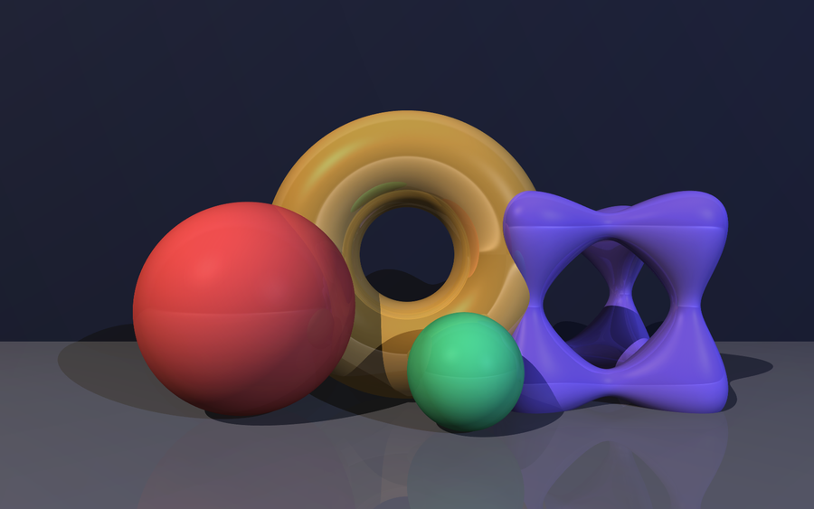
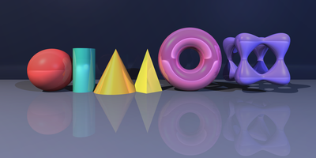
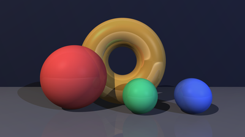
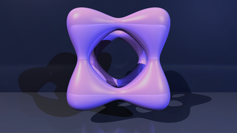
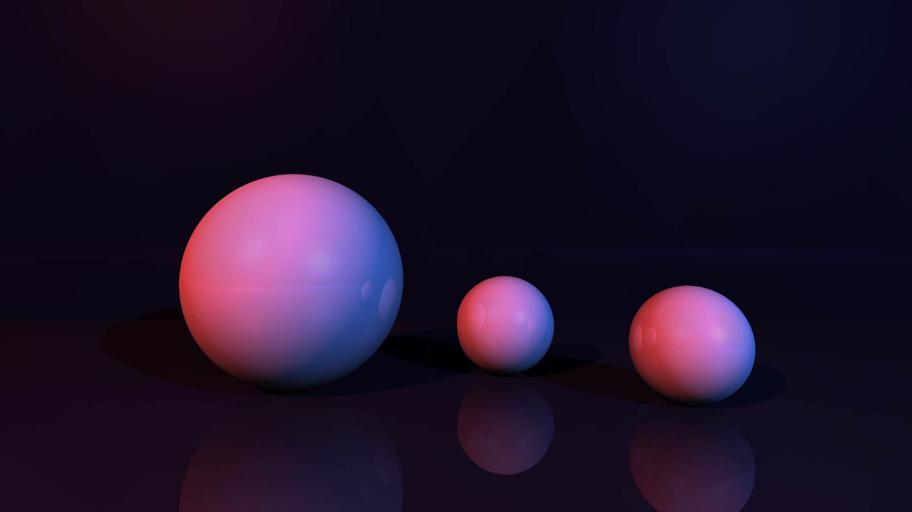
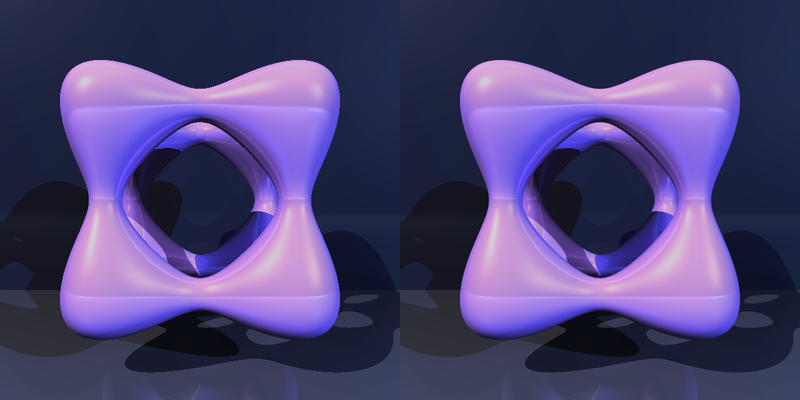

<h1 align="center">Raytracer</h1>

<p align="center">
  <strong>A C++ raytracer for configurable scenes, lighting and reflections.</strong>
</p>

<p align="center">
  <a href=".assets/raytracer-showcase.png">
    
  </a>
</p>

<p align="center">
  <em>A still life with spheres, a torus, a tanglecube and soft reflections.</em>
</p>

## Screenshots

| Primitives | Materials |
| :---: | :---: |
| [](.assets/raytracer-primitives.png) | [](.assets/raytracer-materials.png) |

| Tanglecube | Reflections |
| :---: | :---: |
| [](.assets/raytracer-tangle.png) | [](.assets/raytracer-reflections.png) |

<a href=".assets/raytracer-lighting.png">
  
</a>

*Three spheres under red and blue point lights.*

<a href=".assets/raytracer-antialiasing.png">
  
</a>

*One sample per pixel (left) and adaptive 8/16-sample antialiasing (right).*

## How it works

The renderer casts primary rays through a configurable camera. Scenes can
contain spheres, planes, cylinders, cones, pyramids, toruses and tanglecubes,
lit by point or directional lights. Shading includes ambient and diffuse light,
shadows, specular highlights and floor reflections.

Scenes are libconfig files. The preview uses SFML; the final image is written as
a PPM after the preview window closes.

## Render a scene

```sh
cmake -S . -B build -DCMAKE_BUILD_TYPE=Release
cmake --build build -j
./raytracer scenes/showcase.cfg
```

Close the preview window to write `output.ppm`.

See [`BUILD.md`](BUILD.md) for dependencies, [`scenes/README.md`](scenes/README.md)
for the included scenes, and [`CREDITS.md`](CREDITS.md) for credits.

## Academic notice

EPITECH students: do not copy this code. Using it as your own work is cheating and can lead to disciplinary action.
